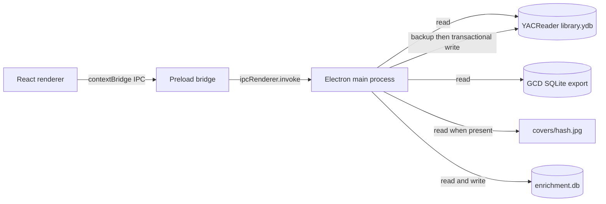

# Architecture And Operations

## Purpose

YAC GCD Scraper is a desktop metadata workspace for a YACReader library and a Grand Comics Database (GCD) SQLite export. It helps a user browse a YACReader library, propose GCD metadata, inspect ambiguous candidates, and selectively fill blank native YACReader fields.

The application is not a replacement YACReader database. `library.ydb` remains the source of library records and can continue to be opened by YACReader. Native writes occur only after a user reviews and confirms an update preview.

## Components

| Component | Location | Responsibility |
| --- | --- | --- |
| Electron main process | `electron/main.mjs` | Opens SQLite databases, checks cover files, matches GCD records, saves enrichment proposals, creates backups, and applies native library updates. |
| GCD sync planner | `electron/gcd-sync.mjs` | Separates missing and differing native metadata, resolves saved-ID versus exact-match policy, and applies approved values with stale-preview rollback protection. |
| Electron preload bridge | `electron/preload.cjs` | Exposes a restricted `window.libraryApi` IPC interface to the renderer. |
| React renderer | `src/App.tsx` | Renders the library browser, filters, matching review, proposal editor, update preview, and controls. |
| Application styles | `src/App.css` | Defines the three-pane desktop layout, cards, dialogs, and responsive constraints. |
| Renderer build | `src/main.tsx`, Vite | Builds the browser-facing React assets into `dist/`. |
| Proposal store | Electron user-data directory, `enrichment.db` | Persists proposed GCD fields outside of the YACReader database. |
| Native library | `yac_data/yacreaderlibrary/library.ydb` by default | Stores YACReader folders, comics, and the native `comic_info` metadata rows. |
| GCD data | `gcd_data/sqlite2026-09-01.db` by default | Supplies issue, series, publisher, indicia publisher, and story metadata. |



## Runtime Data Locations

By default, all paths are resolved relative to the project source tree:

| Data | Default location | Override |
| --- | --- | --- |
| YACReader library | `../../yac_data/yacreaderlibrary/library.ydb` | `YAC_GCD_LIBRARY_PATH` |
| Cover images | `../../yac_data/yacreaderlibrary/covers` | `YAC_GCD_COVERS_PATH` |
| GCD database | `../../gcd_data/sqlite2026-09-01.db` | `YAC_GCD_DATABASE_PATH` |
| Proposals | Electron user-data directory, `enrichment.db` | Not currently configurable |

Cover image filenames are based on the YACReader `comic_info.hash` field. For hash `abc123...`, the app looks for `covers/abc123....jpg`. The main process returns an image URL only if that JPEG exists. Missing images and image load failures retain the visual placeholder.

## User Workflow

1. **Browse the library.** The renderer calls `library:load`; the main process reads folder and comic records from `library.ydb`. Folder navigation limits the list to the selected folder and descendants, and clickable breadcrumbs navigate to any displayed ancestor. Search, metadata, reading, publisher, and GCD-status filters are applied before results are returned.
2. **Edit a comic.** Selecting a card loads any saved proposal from `enrichment.db`. The information button opens an editable YACReader-style dialog for General information, Plot, Authors, Publishing, and Notes. Previous and next follow the active library-list sort order. Save creates a timestamped backup and writes the requested native metadata in one transaction; Cancel does not write.
3. **Find a GCD candidate.** The app initializes editable title, issue, and volume parameters from the selected comic. It evaluates those values, plus filename and path terms, for series similarity, issue number, volume, and publisher evidence, then returns the top candidates with their stories and creator credits. The review session retains its initial library-list ordering after a proposal is saved.
4. **Review or apply a candidate.** The GCD review dialog shows the selected issue and each story. Choosing **Use this GCD record** saves the mapped proposal to `enrichment.db`; it does not change `library.ydb` until the user reviews and confirms **Apply updates**.
5. **Optional batch proposals.** **Auto-match all** scans the entire library and saves a proposal only where exactly one candidate has a score of `100`. Each selected folder also provides **Auto-match** with a choice to include child folders. Existing proposal values are retained by default. Selecting **Overwrite existing proposals** requires an explicit Continue confirmation and replaces each matching proposal instead. Neither mode writes to `library.ydb`.
6. **Preview native updates.** **Apply updates** compares saved proposals with the current `comic_info` schema and values. It shows every field that can be filled plus values skipped because they are invalid, unsupported, already populated, or attached to a missing comic.
7. **Confirm the import.** Confirmation creates a timestamped backup next to the library, then writes all previewed values in one SQLite transaction. The library list reloads after a successful update.

### Sync From The Local GCD Snapshot

**Admin > Sync from GCD** is independent of the blank-only proposal import. It scans each native `comic_info` row associated with a comic once, across the whole library. The scan reads both databases without changing native metadata or saved proposals and reports progress, matches, skipped records, and per-record errors.

Saved `gcdIssueId` values in enrichment proposals take precedence. Invalid IDs or IDs missing/deleted in the current GCD snapshot are skipped, not silently reassigned. Unlinked comics require exactly one score-100 canonical match. Native series, issue, and volume fields take priority over filename/path inference, with native title as a final series fallback. Unknown issue numbers are not auto-matched.

The preview displays every mapped non-empty GCD value that differs from native metadata, with paginated current/GCD comparisons. Missing and differing values are listed separately. Only missing values are selected initially. **Replace differing metadata** explicitly selects all displayed differences, including any manual edits; empty GCD fields never erase native values. Unsupported native columns are skipped. This compares against the supplied local snapshot, not the live GCD website, and cannot establish which differing value is more recent or authoritative.

Confirmation uses a main-process-held preview identified by an opaque ID, not a new scan or renderer-supplied field list. It creates a SQLite-consistent backup and applies the selected changes in one transaction, comparing each target against its previewed original value. If a row disappears or metadata changes after preview, the whole transaction rolls back. **Rescan** generates a new preview before retrying. Comic hashes, paths, reading state, bookmarks, and other non-metadata fields are untouched. Saved proposals are not overwritten by this sync.

## Matching Rules

The matcher normalizes textual values for comparison and derives missing series, issue, and volume data from filenames and paths when possible.

An issue number must be numeric, optionally with one decimal point. Examples: `7`, `7.5`, and `0007` are accepted; the stored proposal becomes `7`, `7.5`, and `7`. Placeholders and alphanumeric issue numbers, including `[nn]`, are not saved as issue-number proposals and are excluded from native import.

Each selected GCD candidate stores its issue metadata, publisher brand, and complete story records in the proposal. The primary story is the first record whose GCD type is `comic story`; when its title is empty, its feature is used as the proposal's story name. This same mapping is used by manual matching and **Auto-match exact**.

Issue and all story `editing` credits are combined for Editor after removing literal `(editor)` annotations. Writer, Penciler, Inker, Colorist, and Letterer combine every non-deleted story's legacy text and structured creator credits. Cover Artist combines pencils and inks from all covers. Exact duplicate credit values are removed. Genres and characters include all stories, synopses retain separate narrative blocks, and Notes combine issue and all story notes. The primary story is used only for descriptive story identifiers/name, not to limit imported metadata.

A candidate score is capped at `100`. The exact-match batch action requires exactly one candidate at `100`; ambiguous or lower-scoring records remain for manual review.

## Proposal And Import Mapping

The proposal store can retain GCD-specific fields that do not have a direct safe native YACReader equivalent, including GCD issue ID, full story JSON, story name, and publisher brand.

The persistent link is `enrichment.comic_info_id` (YACReader `comic_info.id`) to `fields_json.gcdIssueId` (GCD `gcd_issue.id`). Manual saves and automatic proposals persist this link with their fields. A completed sync scan also saves every confirmed match, including matches requiring no metadata changes, without replacing existing proposal fields or links. Cancelling the update preview does not remove confirmed links. Ambiguous, unresolved, or failed matches do not create links. Later proposal edits preserve an existing ID when no replacement ID is supplied. Sync reuses saved IDs on subsequent scans; a conflicting link changed during scanning aborts link persistence transactionally and requires a new preview. Only the app-side proposal database is changed by link discovery; library metadata still requires an explicit apply action.

### Manual Mapping Browser

The Admin menu contains expandable submenus: **Match** (Map library to GCD, Auto-match all), **Update** (Apply update, Alter update), and **Maintenance** (Export updates, Import updates, Sync from GCD). Only one submenu is expanded at a time.

**Admin > Update > Alter update** lists stored proposals in pages of up to 100 rows, one row per comic, with a checkbox and expandable metadata fields. Selections are retained across pages, and the Remove button shows the total selected count. Metadata details are rendered only when expanded, and comic identities are loaded in one bulk library query rather than one lookup per proposal. **Remove** deletes the checked proposal records and their stored GCD links across all pages in a single transaction, then refreshes the list and library proposal indicators. Unchecked records and native YACReader metadata remain unchanged. **Close** dismisses the window without removing proposals.

Enable Advanced tools and choose **Admin > Match > Map library to GCD**. The left pane reuses the native library folder tree and lists individual comics in the selected folder. The right pane browses Publisher > Series > Issue with search and pages of up to 100 GCD records. Both selected records expose their identifying metadata and IDs.

The `gcd:browse` IPC handler reads only the source GCD database. `gcd:create-mappings` validates the selected native comic and GCD issue using their actual database records and stores the persistent link plus the complete extracted proposal in `enrichment.db`. It does not modify `library.ydb` or GCD. Once the anchor pair has been saved, the folder action matches only other comics directly in its native parent folder against issues in the anchor's GCD series. Numeric and decimal issue numbers are normalized, filename/path extraction fills missing native numbers, canonical cover variants collapse to their root issue, and non-unique matches are skipped. Existing links are protected by default; unlinked existing proposal values are retained when batch matching. An explicit replacement opt-in allows links/proposals to be replaced. A concurrent link change aborts the proposal transaction. Saved proposals are available through the normal Apply updates workflow.

The native import uses the following allowlist. A mapping is applied only when the proposal has a non-empty valid value, the target column exists in the installed YACReader schema, and the existing target value is blank.

| Proposal field | Native `comic_info` field | Source rule |
| --- | --- | --- |
| `title` | `title` | GCD issue title, falling back to series name. |
| `issueNumber` | `number` | Numeric or decimal values only. |
| `onSaleDate` | `date` | GCD on-sale date, falling back to publication date. |
| `publisher` | `publisher` | GCD indicia publisher, falling back to GCD publisher. |
| `imprint` | `imprint` | GCD publisher, falling back to GCD indicia publisher. |
| `series` | `series` | GCD series name. |
| `volume` | `volume` | GCD issue volume. |
| `issueCount` | `count` | GCD series issue count, when positive. |
| `editor` | `editor` | Issue and all story editing credits. |
| `coverArtist` | `coverArtist` | Pencils and inks from every cover. |
| `storyGenre` | `genere` | All story genres. |
| `storyCharacters` | `characters` | All story character text and structured appearances. |
| `storySynopsis` | `synopsis` | All story synopses, separated by blank lines. |
| `storyNotes` | `notes` | Issue and all story notes, separated by blank lines. |
| `crossoverArc` | `storyArc` | Names linked through GCD story-arc membership. |
| `crossoverPart` | `arcNumber` | For a single arc, the issue's catalog position among linked non-variant issues, ordered by key date, series, sort code, and ID. |
| `arcCount` | `arcCount` | For a single arc with a resolved position, the number of linked non-deleted, non-variant issues. |
| `script` | `writer` | All story script credits. |
| `pencils` | `penciller` | All story pencil credits. |
| `inks` | `inker` | All story ink credits. |
| `colors` | `colorist` | All story color credits. |
| `letters` | `letterer` | All story lettering credits. |
| `teams` | `teams` | Groups linked to structured story appearances. |
| `mainCharacterOrTeam` | `mainCharacterOrTeam` | Characters/groups with a featured appearance role. |
| `format` | `format` | GCD series format, falling back to publishing format. |
| `ageRating` | `ageRating` | GCD issue rating, not the reader's personal rating. |
| `languageISO` | `languageISO` | GCD series language code. |
| `tags` | `tags` | Tags attached to the issue, series, or non-deleted stories. |

Arc position/count are derived from catalog membership, not explicit printed part numbers; incomplete indexing can produce incomplete counts. Multiple arcs supply names only. The current GCD schema has no dedicated alternative series/number/count, series group, locations, or review fields. These destinations remain blank unless explicitly supplied in a proposal; existing library values are preserved. Optional structured tables are detected per database connection, so older exports retain legacy story-text extraction. Structured joins start from issue/story or arc relationships; unary-plus deletion filters retain deletion checks without allowing SQLite to choose broad low-selectivity deletion indexes in an unanalyzed export.

Saving a selected manual match writes every non-empty mapped field through the metadata editor's transactional save path and stores the full proposal. Unlike Apply updates, this explicit manual save can replace existing mapped values. Auto-match only stores proposals; Apply updates fills blanks; Sync from GCD replaces differing values only when replacement is selected.

The importer checks `PRAGMA table_info(comic_info)` before planning changes. This supports YACReader database versions that do not contain newer columns. It never changes the comic hash, file location, page/reading state, bookmarks, display settings, or non-empty metadata values.

## Safety And Recovery

The native import and GCD sync are deliberately gated:

- Browsing, filtering, searching for matches, storing proposals, exporting, and auto-matching do not modify `library.ydb`. Saving a selected manual match does write its mapped fields after creating a backup.
- Editing comic information changes only the supported General information, Plot, Authors, Publishing, and Notes fields after Save is chosen; it creates a timestamped backup before the transaction.
- The user must review the import preview and choose **Create backup and apply updates**.
- Before a change, the main process makes a SQLite-consistent backup named `library.ydb.yacgcd-backup-<timestamp>.ydb` beside the original library.
- Changes run within a SQLite transaction. A failure rolls back the transaction. The backup remains available even when an update cannot be committed.
- The update statement includes a blank-value condition, preventing values changed after the preview from being overwritten.
- GCD sync applies missing values by default and only replaces populated fields after the explicit replacement opt-in. Its update statements compare exact previewed original values; stale previews roll back all changes.

Close YACReader before applying updates to avoid competing writes to the same library. To recover, close the application and YACReader, then replace the affected `library.ydb` with the relevant timestamped backup. Keep the original and its backup together only long enough to verify the restored library; use normal operating-system backup procedures for long-term retention.

## Development And Packaging

Install dependencies and rebuild the Electron-native SQLite module once for the Electron runtime:

```sh
npm install
npm run rebuild:native
```

Start the desktop application from the project directory:

```sh
npm run dev
```

The command starts Vite, waits for port `5173`, then starts Electron. Closing Electron stops Vite through `concurrently -k`; that combined command can report a nonzero process status even though Electron closed normally.

Use these validation and distribution commands:

```sh
npm run lint
npm run build
npm run package
```

`npm run build` performs TypeScript compilation and creates production renderer assets. `npm run package` first builds and then uses `electron-builder` to make the configured macOS DMG package.

## IPC Boundary

The renderer has no direct SQLite or filesystem access. With `contextIsolation` enabled and Node integration disabled, it can use only the functions exposed from `electron/preload.cjs`:

| Renderer API | Main-process operation |
| --- | --- |
| `loadLibrary(filters)` | Read folders, comic summaries, filter results, and cover URLs. |
| `getComicMetadata(comicId)` | Read one complete native metadata record. |
| `getEnrichment(comicInfoId)` | Read saved proposal fields. |
| `saveEnrichment(comicInfoId, fields)` | Save normalized proposal fields. |
| `findMatches(comic, query)` | Query and score GCD candidates, using the supplied comic title, issue, and volume as refinable criteria. |
| `autoMatchExact({ folderId, recursive, overwriteExisting }?)` | Generate proposals only for unambiguous score-100 candidates in the specified folder; include descendants when `recursive` is true and preserve existing proposals unless `overwriteExisting` is true. |
| `previewImport()` | Produce a non-mutating native-update plan. |
| `importEnrichment()` | Back up and transactionally apply the current plan. |
| `previewGcdSync()` | Scan the entire library against the local GCD snapshot and retain a non-mutating current/GCD preview in the main process. |
| `onGcdSyncProgress(listener)` | Subscribe to native-library scan progress; returns a listener cleanup function. |
| `applyGcdSync({ planId, replaceExisting })` | Back up and transactionally apply that exact preview; protect differing native values unless replacement is explicitly enabled. |
| `exportEnrichment()` | Save all proposals as a JSON update package selected by the user. |

This boundary keeps database credentials, absolute filesystem paths, and write operations out of browser-rendered code.